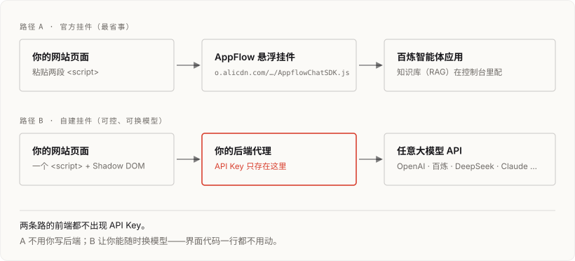

# web-ai-assistant



中英文在同一个文件里，点标题切换。 Both languages live in this file — click a title to switch.

<details open>
<summary><b>中文</b></summary>

给网站加一个 AI 助手挂件。零依赖、不需要构建，断网也有兜底。在线演示：<https://modeling-xju.github.io/web-ai-assistant/>。这是一个 Agent Skill，也可以只拿里面的挂件源码用。

## 装

整个目录丢进技能库即可，Cherry Studio 会自动识别。之后直接说「帮我把 AI 助手加到官网上」就行。

只想拿挂件，拷 `assets/widget/` 里那两个文件（JS 和 CSS 必须同目录）：

```html
<script src="./ai-assistant.js"
        data-waa
        data-transport="echo"
        data-name="小助"></script>
```

`echo` 是本地假回复，不发任何请求。用它确认挂件跑起来了、样式没被站点弄歪，确认完再把 `data-transport` 换成 `openai` 并指向你的后端。

## 为什么会有这个仓库

从阿里云那篇《在网站上增加一个 AI 助手》衍生来的。教程本身是四步链路：百炼建应用 → 拿凭证 → AppFlow 建助手 → 挂到网站。问题是能自动化的部分很少——控制台得人点，剩下的就是往站里插代码，而插代码恰恰是最容易出错的一步。

| 常见的错 | 结果 |
|---|---|
| SDK 加了 `defer`，`init` 写在内联 `<script>` 里 | `APPFLOW_CHAT_SDK is undefined`，挂件根本不出来 |
| `requestDomain` 抄了示例里的 `/chat` | 一发消息就 `Failed to stream content` |
| 直接往 `body` 塞带全局类名的 div | 和站点样式互相污染，很难复现 |
| 把 API Key 写进前端 | 静态页面是公开的，等于公开 |
| SPA 里在组件内 `init` | 路由来回，挂出好几个图标 |
| 打包后样式表找不到 | 渲染成没有样式的裸 HTML |

这几条都写进了流程、校验器和挂件本身。

## 两条路



**A. 官方挂件。** 已经有百炼应用和 AppFlow 集成。前端只暴露 `integrateId` 和 `requestDomain`，API Key 不落地。看 `references/appflow-sdk.md` 和 `references/console-setup.md`。

**B. 自建挂件。** 没有阿里云账号、要私有部署、要接自研模型，或者想先在本地跑通。两个零依赖文件，样式在 Shadow DOM 里，界面只依赖一个 `transport` 契约。看 `references/self-hosted-widget.md`。

## 快捷键

挂件自己绑的：

| 键 | 作用 |
|---|---|
| `Ctrl/⌘ + K` | 打开 / 收起助手 |
| `Ctrl/⌘ + /` | 快捷键表 |
| `Ctrl/⌘ + Shift + H` | 历史与记忆 |
| `Ctrl/⌘ + Shift + O` | 新对话 |
| `Esc` | 收起（抽屉开着时先关抽屉） |
| `Alt + ↑` / `Alt + ↓` | 上一个 / 下一个会话 |
| `Enter` / `Shift + Enter` | 发送 / 换行 |
| `Ctrl/⌘ + Enter` | 发送（任何情况下） |
| `↑` | 取回上一条提问（输入框为空时） |

输入框里的系统默认键，挂件既不绑定也不拦截：

| 键 | 作用 |
|---|---|
| `Ctrl/⌘ + C` / `+ X` / `+ V` | 复制 / 剪切 / 粘贴 |
| `Ctrl/⌘ + A` | 全选 |
| `Ctrl/⌘ + Z` / `+ Shift + Z` | 撤销 / 重做 |
| `Ctrl/⌘ + F` | 页内查找（浏览器自己的） |

把动作绑到这些键上会被拒绝并打告警，退回默认键。一个聊天挂件把用户的 `Ctrl+C` 弄坏，比少一个快捷键严重得多。

重绑用 `hotkeys: { toggle: 'mod+shift+k' }`，整块关掉用 `shortcuts: false`。

## 挂件带什么

点面板外面收起、多会话历史、跨访问的记忆、热词、知识库引用、离线兜底、11 家大模型 API 预设，以及一个可选的「在界面上选服务商填 key」面板。这些是配置项，不是要你写的代码。

**记忆**是持久化的，每次请求会拼成一条 system 消息带上。用法：

```js
widget.remember({ 门店: '杭州西湖店' });
```

**热词**可以从后端拉，拉不到就用静态兜底：

```js
WebAIAssistant.mount({ hotWords: ['保修怎么查'], hotWordsUrl: '/api/hot-words' });
```

**知识库（RAG）是干什么的**：模型只知道自己训练时见过的东西，问它「你们 A1 保修几年」它要么说不知道，要么编一个。RAG 就是提问时先去你的文档里检索出相关片段，连同问题一起塞给模型，让它照着资料回答，并把来源摆出来给用户核对。

挂件**不做检索**——检索要在你的后端或百炼控制台里配。它管两件事：把 `knowledge` 配置下发给后端，以及把返回的 `references`（或 `citations` / `sources` / `search_info`）渲染成可展开的「参考资料」。没用知识库就完全不用管这一项。

**离线**：断网时状态栏显示「离线」，不会转圈转到天荒地老。能配一组本地问答，命中就直接答（不联网），并标上「离线应答」；答不了的给一句人话，记住这条问题，恢复联网自动补发。

```js
WebAIAssistant.mount({
  offline: {
    answers: [{ match: /保修|维修/, reply: '整机保修 3 年，机芯 5 年。' }],
    resend: true
  }
});
```

**大模型**用 `provider` 预设省去抄地址：

| provider | 协议 |
|---|---|
| `openai` `deepseek` `moonshot` `zhipu` `siliconflow` `openrouter` `ollama` `vllm` | OpenAI 兼容 |
| `dashscope` | 百炼兼容模式 |
| `dashscopeApp` | 百炼智能体应用 |
| `anthropic` | Anthropic Messages（单独适配器） |

```js
WebAIAssistant.mount({ provider: 'deepseek', apiKey: '…' });
```

**上面这行只适合本机开发、内网、或 Ollama。** 公开站点上任何访客按 F12 就能拿到 key。生产环境走 `浏览器 → 你自己的后端（key 在这里）→ 大模型 API`，后端只把 `{messages}` 转成上游协议、SSE 原样转发回来即可。FastAPI 和 Node 两份实现见 `references/self-hosted-widget.md`。

**在界面上直接配。** 打开 `setup: true`，挂件里会多一个齿轮：选服务商、填 key、点「测试连接」（真的发一个最小请求过去验证），保存立刻生效、不用刷新。本机开发、内网工具、给同事试用时很省事。

**它是默认关的**（`setup: false`），别在公开站点上打开——访客会看到一个配置入口，而且只要浏览器里存过 key，这个域下任何脚本都能读到。居中一点的选法是 `setup: 'auto'`：只有检测到「用了服务商预设但没填 key」时才显示入口。演示页也保持默认关闭，想看的话在地址后加 `?setup=1`。

## 校验器

```bash
bun scripts/verify-embed.mjs ./你的站点
```

扫占位符没换、域名填成相对路径、`init` 时序错、密钥泄漏、样式表漏拷。有 error 时退出码 1，可以当交付闸门。加 `--json` 输出机器可读结果。

## 目录

```
SKILL.md                        Agent 的执行流程与约束
SKILL.en.md                     同一份的英文版
index.html                      在线演示（本身就是用法示例）
docs/                           README 里的两张 SVG
references/                     SDK、控制台、自建挂件、排障、设计
assets/widget/                  挂件源码
scripts/verify-embed.mjs        接入配置校验器
evals/                          评测用例与站点样本
```

## 设计

挂件的默认外观避开了「蓝紫渐变圆球 + 大圆角气泡 + 层层阴影」。用发丝描边代替阴影，唯一的彩色只出现在"正在生成"和未读提示上，助手侧不用气泡而用一条竖线起头。配色走 CSS 变量，改四个就能融进站点。

理由写在 `references/design.md`。

</details>

<details>
<summary><b>English</b></summary>

Embed an AI assistant into a website. Zero dependencies, no build step, and a fallback when the network is down. Live demo: <https://modeling-xju.github.io/web-ai-assistant/>. This is an Agent Skill, or you can just take the widget source out of it.

## Install

Drop the whole directory into your skills folder — Cherry Studio picks it up automatically. Then just say "add an AI assistant to our website".

If you only want the widget, copy the two files in `assets/widget/` (the JS and CSS must sit in the same directory):

```html
<script src="./ai-assistant.js"
        data-waa
        data-transport="echo"
        data-name="小助"></script>
```

`echo` is a local fake reply that makes no network requests. Use it to confirm the widget runs and that the site's styles haven't bent it out of shape. Then switch `data-transport` to `openai` and point it at your backend.

## Where this came from

It grew out of Alibaba Cloud's tutorial "Adding an AI assistant to a website". The tutorial is a four-step chain: create a Bailian app → grab credentials → create an AppFlow assistant → embed it in the site. The trouble is how little of that can be automated. Someone has to click through the console, and what's left is pasting code into a site — which is exactly the step that goes wrong.

| How it goes wrong | What you get |
|---|---|
| You add `defer` to the SDK and put `init` in an inline `<script>` | `APPFLOW_CHAT_SDK is undefined`; the widget never shows up |
| You copy the `/chat` from an example into `requestDomain` | `Failed to stream content` on the first message |
| You drop a div with global class names into `body` | The widget and the site's styles fight each other, and it's hard to reproduce |
| You put the API key in the frontend | A static page is public, so the key is public |
| You call `init` inside an SPA component | Route changes stack up several launchers |
| The stylesheet can't be found after bundling | The widget renders as unstyled HTML |

Those cases are baked into the workflow, the checker, and the widget itself.

## Two routes


**A. The official widget.** For when you already have a Bailian app and an AppFlow integration. The frontend only exposes `integrateId` and `requestDomain`; the API key never lands there. See `references/appflow-sdk.md` and `references/console-setup.md`.

**B. The self-hosted widget.** For when you have no Alibaba Cloud account, need private deployment, want to wire up your own model, or just want to get it running locally first. Two dependency-free files, styles inside a shadow root, and the UI only depends on a single `transport` contract. See `references/self-hosted-widget.md`.

## Keyboard

Bound by the widget:

| Key | Action |
|---|---|
| `Ctrl/⌘ + K` | Open / close the assistant |
| `Ctrl/⌘ + /` | Shortcut sheet |
| `Ctrl/⌘ + Shift + H` | History and memory |
| `Ctrl/⌘ + Shift + O` | New chat |
| `Esc` | Collapse (closes the drawer first if it's open) |
| `Alt + ↑` / `Alt + ↓` | Previous / next conversation |
| `Enter` / `Shift + Enter` | Send / new line |
| `Ctrl/⌘ + Enter` | Send (always) |
| `↑` | Recall the last question (when the input is empty) |

System keys inside the input, which the widget neither binds nor intercepts:

| Key | Action |
|---|---|
| `Ctrl/⌘ + C` / `+ X` / `+ V` | Copy / cut / paste |
| `Ctrl/⌘ + A` | Select all |
| `Ctrl/⌘ + Z` / `+ Shift + Z` | Undo / redo |
| `Ctrl/⌘ + F` | Find in page (the browser's own) |

Binding an action to one of those is rejected with a warning and falls back to the default. A chat widget breaking someone's `Ctrl+C` is a much worse accident than missing one shortcut.

Rebind with `hotkeys: { toggle: 'mod+shift+k' }`, or turn the whole set off with `shortcuts: false`.

## What the widget ships with

Click-outside to collapse, multiple conversations, persistent memory, hot words, knowledge-base citations, offline fallbacks, eleven LLM provider presets, and an optional in-widget provider/key setup panel. All of it is configuration, not code you have to write.

**Memory** is persisted and rides along as a system message on every request:

```js
widget.remember({ store: 'Hangzhou West Lake' });
```

**Hot words** can come from your backend, with a static fallback:

```js
WebAIAssistant.mount({ hotWords: ['warranty'], hotWordsUrl: '/api/hot-words' });
```

**Knowledge base (RAG), and why you'd want it.** A model only knows what it saw during training. Ask it "how long is the warranty on your A1" and it will either say it doesn't know or make something up. RAG means: at question time, retrieve the relevant passages from your own documents, hand them to the model along with the question, and show the sources so the user can check.

The widget **does not do retrieval** — that happens in your backend or in the Bailian console. It does two things: passes the `knowledge` config down to your backend, and renders the returned `references` (or `citations` / `sources` / `search_info`) as an expandable "Sources" block. If you don't use a knowledge base, none of this applies.

**Offline.** With no connection the status line reads "Offline" instead of spinning forever. You can configure a local FAQ that answers without any network at all (marked "Offline answer"), and when it can't answer, the widget says so in plain language, remembers the question, and resends it once the connection is back.

```js
WebAIAssistant.mount({
  offline: {
    answers: [{ match: /warranty|repair/, reply: 'Three years on the unit, five on the mechanism.' }],
    resend: true
  }
});
```

**Models** — `provider` presets save you from copying endpoints:

| provider | Protocol |
|---|---|
| `openai` `deepseek` `moonshot` `zhipu` `siliconflow` `openrouter` `ollama` `vllm` | OpenAI-compatible |
| `dashscope` | Bailian compatible mode |
| `dashscopeApp` | Bailian agent app |
| `anthropic` | Anthropic Messages (its own adapter) |

```js
WebAIAssistant.mount({ provider: 'deepseek', apiKey: '…' });
```

**That line only suits local development, an intranet, or Ollama.** On a public site anyone can hit F12 and take the key. In production: `browser → your own backend (key lives here) → the LLM API`. The backend just translates `{messages}` into the upstream protocol and passes the SSE frames back through. Both a FastAPI and a Node implementation are in `references/self-hosted-widget.md`.

**Or configure it in the UI.** Turn on `setup: true` and the widget grows a gear: pick a provider, paste a key, hit "Test connection" (it really fires a minimal request to check), and the change applies immediately without a reload. Handy for local work, internal tools, and letting a colleague try it.

**It's off by default** (`setup: false`) — don't turn it on for a public site. Visitors would see a config entry point, and once a key is in the browser, any script on that origin can read it. `setup: 'auto'` is the middle ground: the entry point only appears when the widget detects a provider preset with no key. The demo keeps it off too; add `?setup=1` to the URL if you want to see it.

## Checker

```bash
bun scripts/verify-embed.mjs ./your-site
```

It flags unreplaced placeholders, relative domains, `init` ordering mistakes, key leaks, and a missing stylesheet. Exit code 1 when there are errors, so it works as a delivery gate. Add `--json` for machine-readable output.

## Layout

```
SKILL.md                        Agent workflow and constraints (Chinese)
SKILL.en.md                     English version of the same
index.html                      Live demo (itself a usage example)
docs/                           The two SVGs used above
references/                     SDK, console setup, self-hosted widget, troubleshooting, design
assets/widget/                  Widget source
scripts/verify-embed.mjs        Embed-config checker
evals/                          Eval cases and fixture sites
```

## Design

The default look avoids the blue-purple gradient bubble, the fat rounded corner, and the stacked shadow. Hairline borders do the work instead, the only colour shows up on the streaming caret and the unread dot, and the assistant's replies are marked by a vertical rule rather than a bubble. Colours are CSS variables — changing four of them folds the widget into a site.

The reasoning is in `references/design.md`.

</details>

## License

MIT

